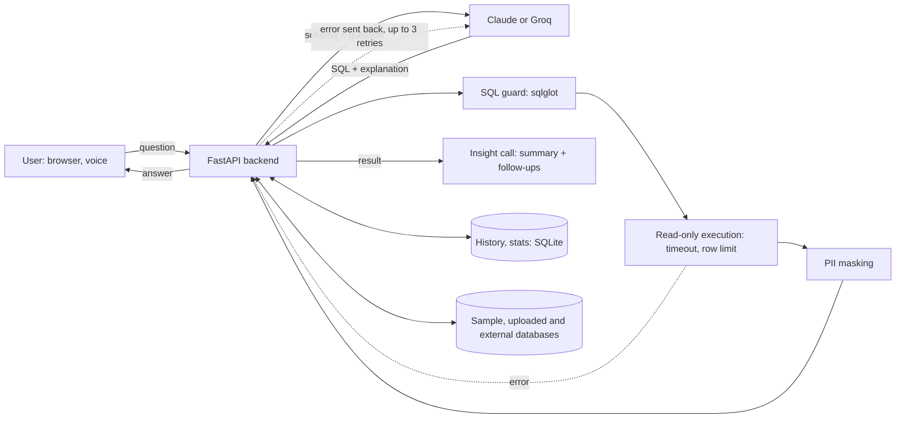

# Sawaal: a natural-language interface to databases

*Minor project, 7th semester. This file is written so that its sections can be copied into the project report.*

## 1. Abstract

Most of the world's useful data sits in relational databases, but getting an answer out of it requires SQL, which
many people never learn. Sawaal lets a user type a question in English (or Hinglish, or speak it in English or
Hindi) and get back the answer as a plain-language sentence, a table and a chart, together with the SQL that produced
it. A large language model writes the query, a safety layer guarantees that it can only read data, the database
runs it, and if the database reports an error the model repairs the query automatically. The system also measures
its own accuracy on a benchmark of questions with known-correct SQL.

## 2. Problem statement

- Business users, students and officials need answers from data but cannot write SQL.
- Letting an AI write SQL is risky: it may produce a query that modifies data, exposes personal information, or is
  simply wrong, and the user has no way to tell.
- Therefore a useful system must be **accurate**, **safe**, **transparent** (always show the SQL) and **measurable**.

## 3. Objectives

1. Convert natural-language questions to correct SQL for any relational database.
2. Guarantee read-only access, even if the model misbehaves.
3. Recover from errors automatically.
4. Present answers so that non-technical users understand them (summary, table, chart).
5. Measure accuracy with a repeatable benchmark.
6. Protect personal data and limit abuse.

## 4. System architecture



| Layer | Technology | Role |
| --- | --- | --- |
| Frontend | React 19, TypeScript, Vite, CodeMirror, Recharts | Chat interface, SQL editor, charts, dashboard, ER diagram |
| Backend | Python 3.11+, FastAPI, SQLAlchemy | API, schema reading, execution, history |
| AI | Anthropic Claude, Groq (free tier) | Question to SQL, summaries, explanations, database routing |
| Safety | sqlglot | Parses SQL and allows only a single read query |
| Storage | SQLite | Sample databases, uploads, history |

## 5. Modules

1. **Schema reader.** Reads tables, columns, keys, row counts, sample rows and the values of short categorical
   columns, and puts them into the prompt so the model uses exact names and spellings.
2. **SQL generator.** Structured JSON output (`answerable`, `sql`, `explanation`). The schema part of the prompt is
   cached to cut cost. Follow-up questions receive the previous questions and SQL as context.
3. **SQL guard.** Rejects everything except one `SELECT`. Blocks `INSERT`, `UPDATE`, `DELETE`, `DROP`, `ATTACH`,
   `PRAGMA`, `SELECT ... INTO`, multiple statements and dangerous functions.
4. **Executor.** Read-only connection, 15 second timeout, 1,000 row cap.
5. **Self-repair loop.** A database error is sent back to the model, which writes a corrected query.
6. **Database router.** If the selected database lacks the data, the model picks the database that has it.
7. **Insight engine.** Writes a plain-language answer and three follow-up questions from the result rows.
8. **Explainer.** Explains any query step by step.
9. **Privacy layer.** Hides columns that look like personal data (email, phone, Aadhaar, card numbers).
10. **Rate limiter.** Limits AI questions per client per minute.
11. **Data profiler.** Per-column empty counts, distinct counts, ranges and quality flags. No AI.
12. **ER diagram.** Drawn from foreign keys.
13. **Dashboard.** Pinned queries re-run live as charts.
14. **History and usage statistics.** Success rate, repairs, answer time, questions per day.
15. **Evaluation harness.** See section 7.
16. **Importer.** CSV files become tables; SQLite files are attached.
17. **Connection manager.** PostgreSQL and MySQL databases are added at run time. Only those two drivers are accepted
    (a SQLite URL would let a caller read any file on the server). The URL is tested, then stored encrypted with Fernet.
18. **Document search (RAG).** Files are split into passages of about 900 characters, tagged with their page, and ranked
    with BM25. The best six passages go to the model, which must answer only from them and cite them by number.
    When a database is chosen, the question is also answered in SQL and the top rows are added as one more source.
19. **Dashboard suggester.** The model proposes charts from the schema; each query is run through the same guard and
    dropped if it fails or returns nothing. Without an AI key, rules over column types build the charts instead.
20. **Training memory.** Confirmed question and SQL pairs and plain-language business rules are stored per database.
    For each new question the three most similar examples and up to eight rules (BM25) are added to the prompt, so
    accuracy improves with use. Taught SQL passes the read-only guard before it is saved.
21. **Roles and audit.** Viewer, analyst and admin roles, scrypt password hashing and HttpOnly session cookies. Tables
    listed in `RESTRICTED_TABLES` are hidden from a viewer's schema and blocked at execution, including through
    CTEs. Every question, upload, connection, login and denied request is written to an audit log.
22. **Streaming.** `/api/generate/stream` sends server-sent events (reading schema, writing SQL, repairing) so the
    page shows progress instead of a spinner.
23. **Demo mode.** An offline stand-in for the model that answers the benchmark questions, for presentations.

Items 20 to 22 adopt ideas from the open-source Vanna 2.0 project (MIT): agent memory, user-aware permissions, an
audit logger and streaming. Sawaal keeps its own foundation: read-only guard, self-repair, routing, documents,
dashboards and connections.

## 6. Security design

| Threat | Defence |
| --- | --- |
| The model (or a user) writes a destructive query | sqlglot allow-list, then a read-only database connection, so two independent layers must fail |
| Runaway queries | Timeout and row cap |
| Leaking personal data | Column-name based masking on every result |
| Burning the AI quota | Per-client rate limit |
| Stolen connection passwords | Connection strings are encrypted at rest; only PostgreSQL/MySQL URLs are accepted, so no file access through a URL |
| The model inventing facts about documents | It may only answer from numbered passages and must cite them; no match means "not found" |
| A viewer reads salary or review tables | Restricted tables are removed from the prompt and schema, and refused at execution by parsing the SQL (CTE aliases excluded) |
| Unattributed actions | Audit log with user, role, action, status and address |
| Prompt injection through data | The model can only produce SQL, which is validated; it never executes anything itself |

## 7. Evaluation

The benchmark (`backend/eval/golden.json`) holds 29 questions on four databases, graded easy, medium and hard, each
with a known-correct query. The metric is **execution accuracy**, the standard used by the Spider benchmark: a
generated query is correct when it returns the same data as the gold query, regardless of how it is written. The
comparison ignores row order and column order, tolerates rounding, and allows extra columns.

```bash
cd backend && python -m app.evaluate --delay 3
```

Record your results here after running it:

| Model | Easy | Medium | Hard | Overall | Right on first try | Avg. time |
| --- | --- | --- | --- | --- | --- | --- |
| *(fill in)* | | | | | | |

## 8. Testing

170+ automated tests (pytest) cover SQL safety, schema reading, CSV import, the API, database routing, repair,
insights, explanations, masking, profiling, statistics, rate limiting and the benchmark itself. The AI is replaced by
a scripted stand-in, so the suite runs offline and without an API key. A GitHub Actions workflow runs the tests, the
linter and the frontend build on every push.

## 9. Results and screenshots

*(Add screenshots of: the Ask page with an answer, the dashboard, the ER diagram, the data-quality page, the usage
page and the command palette.)*

## 10. Limitations

- Accuracy depends on the model; very ambiguous questions may need a follow-up.
- Only the first 25 result rows are sent to the model for the written summary.
- Document search is keyword based (BM25), so a question that uses different words from the document may miss it; scanned PDFs need OCR first.
- Masking is name-based, so a personal column with an unusual name is not hidden.
- The rate limiter is in memory and per process.

## 11. Future scope

- Login and per-user history.
- Embedding-based retrieval for documents, and OCR for scanned files.
- Excel upload and export.
- Query result caching and scheduled dashboards.
- Fine-tuned or locally hosted models for offline use.
- Column-level permissions per user.
